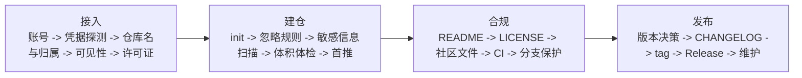

# manage-github-projects

面向个人 GitHub 项目的 Agent Skill：从「想把这个项目放到 GitHub 上」开始，经过公开范围确认、建仓与首次推送、开源合规体检、语义化版本发布，逐阶段推进到持续可维护的开源仓库。

这个 Skill 只覆盖 GitHub 个人项目。它不索取你的密码、token 或验证码，也不替你在网页上完成登录、双因素验证和删除确认。

## 解决什么问题

很多人卡住的不是 `git push` 本身，而是这些前置判断：

- 哪些文件不能公开，密钥和构建产物有没有混进去；
- 仓库该建在哪个账号下、用 public 还是 private；
- 到底要不要加 LICENSE，加哪一种，别人能不能合法复用；
- 为什么 README 写了还是没人会用；
- tag、`package.json`、CHANGELOG 和 Release 的版本号为什么对不上；
- 哪些操作一旦做了就收不回来。

这个 Skill 把流程固定成四个阶段，并设置明确的确认门禁：



每个阶段只推进一个明确任务。用户没有确认公开范围、首推范围和发布方案之前，Skill 不会创建远程仓库、不会提交、也不会推送。

## 核心特点

- **凭据只读不落地**：只探测用户环境里已配置的凭据（`git credential`、凭据管理器、`gh auth`、SSH agent），报告时脱敏，绝不回显 token 明文。
- **推送前强制扫描**：敏感信息扫描和体积体检是建仓阶段的硬性步骤，命中时停下来报告，不允许「先推上去再删」。
- **危险操作单项授权**：`force push`、`git filter-repo` 历史重写、删除仓库、更改可见性、删除 tag/Release 都必须单独说明目标、影响、不可逆后果和备份方式，并等待用户对该项单独授权。
- **版本号单一事实来源**：tag、`package.json`、CHANGELOG 顶部条目、Release 标题必须一致；已发布的 tag 不得移动，修正只能发新版本。
- **可执行体检**：`repo_doctor.py` 只读检查仓库结构、忽略规则、社区文件、CI、疑似密钥、大文件与垃圾产物，结论按 **阻塞 / 建议 / 可选 / 通过** 分级。
- **证据等级**：L1 静态、L2 本地 Git、L3 远程 API、L4 CI、L5 发布物，低等级证据不得冒充高等级。
- **状态持久化**：把规划、进度、决策、版本变更、测试和发布检查保存到项目的 `docs/github/`，以文件而不是聊天记忆作为事实来源。
- **不替用户做法律与产品决策**：许可证、可见性、归档与删除由用户确认，建议必须标注为建议。

## 四阶段与门禁

| 阶段 | 内容 | 门禁 |
| --- | --- | --- |
| 1. 接入 | 账号与凭据可用性、仓库名与归属、可见性、许可证、公开范围 | 目标信息收齐 → 公开范围确认 |
| 2. 建仓 | 本地初始化、忽略规则、敏感信息扫描、体积体检、首次提交与推送 | 首推范围确认 |
| 3. 合规 | README、LICENSE、社区文件、Issue/PR 模板、CI、分支保护 | 阻塞项清零 |
| 4. 发布 | 版本决策、CHANGELOG、tag、GitHub Release、发布后核验与维护 | 发布方案确认 |

「下一步」「好的」「可以」「开始吧」这类泛化回复不算通过门禁；必须针对当前门禁明确回复「公开范围确认」「首推范围确认」或「发布方案确认」。

## 安装

### 推荐：让 Agent 自动安装

不需要手动复制文件。打开支持 Agent Skills 的 Codex、Claude Code 或其他 coding agent，把下面这段提示词直接发给它：

```text
请帮我安装这个 Agent Skill：
https://github.com/ReefBlank/manage-github-projects

请按以下要求执行：
1. 优先使用你当前环境提供的 Skill 安装工具（例如 skill-installer）。
2. 将仓库根目录作为一个完整 Skill 安装；根目录中的 `SKILL.md` 是 Skill 入口。
3. 安装到当前用户的 Skills 目录，不要放进我的业务项目目录。
4. 安装后的入口应为 `<Skills目录>/manage-github-projects/SKILL.md`，不要额外嵌套同名目录。
5. 如果已经存在同名 Skill，先检查版本和来源；不要直接覆盖，先告诉我并等待确认。
6. 安装后检查 `SKILL.md` 和 `agents/openai.yaml`，并在环境支持 Python 时运行仓库自带的校验脚本。
7. 最后告诉我实际安装路径、校验结果，以及如何启用这个 Skill。
```

安装完成后，可以显式调用：

```text
$manage-github-projects
```

如果 Agent 没有专用安装器，它也应该自动从 GitHub 获取仓库，并把仓库根目录安装为 `manage-github-projects`。具体 Skills 根目录由对应工具决定，`agents/openai.yaml` 是 Codex 的可选界面元数据。

### DeepSeek Harness（DSH）用户目录安装

DSH 把用户级 Skill 放在 `~/.dsh/skills/`，Agent 预设放在 `~/.dsh/.agent-presets/`：

```powershell
# Skill 目录（入口：~/.dsh/skills/manage-github-projects/SKILL.md）
git clone https://github.com/ReefBlank/manage-github-projects "$env:USERPROFILE\.dsh\skills\manage-github-projects"

# DSH agent 预设
$preset = "$env:USERPROFILE\.dsh\.agent-presets\manage-github-projects"
New-Item -ItemType Directory -Force -Path "$preset\skills" | Out-Null
Copy-Item -Recurse -Force "$env:USERPROFILE\.dsh\skills\manage-github-projects" "$preset\skills\"
```

更省事的方式是直接运行仓库自带的一键安装脚本，它会同时装好 Skill 和预设：

```powershell
python scripts/install_dsh_preset.py
```

完整说明（含手工安装、启用、排错与卸载）见 [docs/dsh-preset.md](docs/dsh-preset.md)。

## 使用示例

```text
我想把这个本地项目传到 GitHub 上，并且开源。
```

首轮不会假设仓库名、可见性、许可证或「不需要 LICENSE」，而是先问会改变路线的最少问题。确认公开范围后才初始化仓库并推送。

```text
帮我给这个仓库做一次体检，然后发布 v1.0.0。
```

Skill 会先跑 `repo_doctor.py`，按 阻塞 / 建议 / 可选 / 通过 分级汇报；阻塞项清零并通过「发布方案确认」门禁后才创建 tag 和 Release。

## 项目文件

使用过程中，Skill 会在用户确认公开范围并同意建立项目记录后初始化：

```text
docs/github/
├── project-plan.md       # 仓库信息、公开范围、合规基线与发布规划
├── progress.md           # 当前阶段、门禁记录与逐项进度
├── decisions.md          # 重要选择及原因、危险操作授权记录
├── version-change.md     # 版本变更单与版本号一致性检查
├── test-report.md        # 实际执行过的验证及证据等级
└── release-checklist.md  # 发布前检查清单
```

项目文件只记录仓库名、可见性、许可证、默认分支和版本号等非秘密标识。**禁止记录密码**、token、私钥、验证码和个人证件信息，`validate_project_state.py` 会在校验时拒绝这类内容。

## 包含内容

```text
manage-github-projects/
├── SKILL.md
├── agents/openai.yaml
├── references/
│   ├── auth-and-safety.md      # 凭据与安全红线
│   ├── repo-setup-stage.md     # 阶段 2 建仓手册
│   ├── repo-audit.md           # 阶段 3 合规体检手册
│   ├── release-stage.md        # 阶段 4 发布手册
│   ├── maintenance.md          # 日常维护手册
│   ├── state-persistence.md    # 状态持久化约定
│   ├── acceptance-tests.md     # T01-T40 验收用例表
│   └── official-links.md       # 官方入口链接清单
├── assets/project-docs/        # docs/github/ 状态模板
├── preset/
│   ├── preset.yml              # DSH 预设界面元数据
│   └── agent.cordis.yml        # DSH agent-plane 组合
├── docs/dsh-preset.md          # DSH 安装、启用与排错说明
├── scripts/
│   ├── init_project_state.py       # 初始化状态文件（不覆盖已有）
│   ├── validate_project_state.py   # 校验状态文件并拒绝凭据
│   ├── repo_doctor.py              # 只读仓库体检，输出分级报告
│   ├── install_dsh_preset.py       # 一键安装到 DSH 用户目录
│   └── validate_skill.py           # 校验 Skill 结构与行为标记
└── tests/test_scripts.py
```

## 本地验证

在 Skill 目录运行：

```powershell
python scripts/validate_skill.py .
python scripts/validate_skill.py . --check-links
python -m unittest discover -s tests -v
```

只读体检一个已有仓库：

```powershell
python scripts/repo_doctor.py <project-root>
python scripts/repo_doctor.py <project-root> --json
```

初始化并校验项目状态文件：

```powershell
python scripts/init_project_state.py <project-root>
python scripts/validate_project_state.py <project-root>
```

`repo_doctor.py` 返回 0 只代表没有 阻塞 项，属于 L1 静态证据，不能替代远程仓库状态核验、CI 结论或 Release 可下载性验证。

## 重要官方入口

- [Git 官方文档](https://git-scm.com/doc)
- [GitHub Docs](https://docs.github.com/)
- [GitHub REST API](https://docs.github.com/rest)
- [GitHub 仓库可见性说明](https://docs.github.com/repositories/managing-your-repositorys-settings-and-features/managing-repository-settings/setting-repository-visibility)
- [GitHub Releases](https://docs.github.com/repositories/releasing-projects-on-github/about-releases)
- [GitHub Actions](https://docs.github.com/actions)
- [Dependabot](https://docs.github.com/code-security/dependabot)
- [Choose a License](https://choosealicense.com/)
- [Semantic Versioning](https://semver.org/)
- [Keep a Changelog](https://keepachangelog.com/)
- [Conventional Commits](https://www.conventionalcommits.org/)
- [Contributor Covenant](https://www.contributor-covenant.org/)
- [SPDX License List](https://spdx.org/licenses/)

## 许可证

本项目采用 [MIT License](LICENSE)。第三方文档、模板和社区规范仍受其各自许可证约束。
